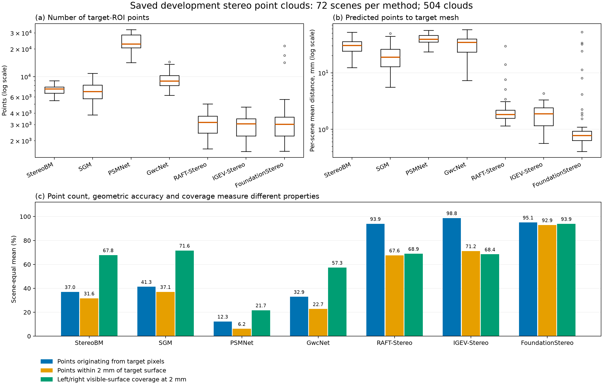

# 点云阶段分析（2026-10-12）

实验已按用户要求停止。本报告仅分析已有的 72 个开发场景 × 7 个双目方法，共 504 份点云，没有重新运行模型或机械臂，也没有修改算法参数。

## 数量满足接口要求，精度和目标提取质量存在差异

504 份点云全部通过当前抓取输入接口校验，未发现空点云、非有限坐标或来源哈希不一致。目标工件点数为 1,531–32,581，均超过现有接口的 128 点下限。这个下限只决定接口是否接受输入，不是抓取成功所需精度的标准。

点数为每种方法 72 个场景的中位数；两个比例和表面误差均先逐场景计算，再对 72 场景等权平均。

| 方法 | 工件点数中位数 | 距目标表面 2 mm 内的点 | 左右可见表面 2 mm 覆盖率 | 平均表面误差（mm） |
|---|---:|---:|---:|---:|
| StereoBM | 7,367 | 31.6% | 67.8% | 30.30 |
| SGM（StereoSGBM） | 6,873 | 37.1% | 71.6% | 20.15 |
| PSMNet | 22,682 | 6.2% | 21.7% | 40.07 |
| GwcNet | 8,977 | 22.7% | 57.3% | 32.92 |
| RAFT-Stereo | 3,178 | 67.6% | 68.9% | 2.59 |
| IGEV-Stereo | 3,062.5 | 71.2% | 68.4% | 1.86 |
| FoundationStereo | 3,034 | 92.9% | 93.9% | 3.02 |

“距目标表面 2 mm 内的点”描述输出目标点云的准确程度；“覆盖率”描述左右相机能看到的真实目标表面采样点有多少在附近 2 mm 内找得到预测点，不包括背面等不可见表面的完整重建能力。平均表面误差为预测目标点到真值目标网格的最近距离，不是目标像素的深度误差。

FoundationStereo 在这批数据中的覆盖率和近表面点占比较高，有作为后续抓取输入的依据；IGEV-Stereo 的平均表面误差较小，RAFT-Stereo 和 IGEV-Stereo 的覆盖率约为 68%–69%。这是当前场景与参数下的开发结果，不是所有应用中的方法排名。

FoundationStereo 也有异常案例：6/72 场景的平均表面误差超过 5 mm，最大为 52.47 mm。完整逐场景记录保留了这些异常，没有删除后重算。

## 部分多出来的点来自非目标像素

将已保存的每一个目标点投影到左相机原图，并用仿真真值实例编号核对其像素是否属于目标工件。全部投影与原像素的偏差小于 0.01 像素。真值仅在离线评价中读取，没有输入双目方法或抓取模型。

| 方法 | 输出工件点中来自真实目标像素的比例 |
|---|---:|
| StereoBM | 37.0% |
| SGM | 41.3% |
| PSMNet | 12.3% |
| GwcNet | 32.9% |
| RAFT-Stereo | 93.9% |
| IGEV-Stereo | 98.8% |
| FoundationStereo | 95.1% |

PSMNet 虽然输出较多工件点，平均只有 12.3% 来自真实工件像素；其余来自其他可见表面或背景像素。来自工件像素的点仍可能存在深度误差，来自其他像素的点也可能碰巧落在工件附近，因此像素来源和表面误差是两个不同的指标。

核对当前代码确认，工件提取使用固定三维区域、预测高度超过桌面 3 mm 和近邻离群点过滤，没有实例分割。深度误差可能把桌面或其他表面的点移入该区域，区域内其他物体也可能被纳入。现有过滤平均保留约 96%–99% 的候选目标点，不能保证清除成片的非目标点。

下一步应区分“目标像素本身的深度误差”与“工件提取混入非目标点”。已有数据证实一些组合的非目标点占比很高，不能将其后续失败全部归因于抓取生成模型。本轮没有修改提取方法或用真值替换输入，也没有新增精度合格阈值。

## 可复现材料

- [逐场景数据](../data/development_pointclouds_20261012_v2/per_scene.csv)：504 行，保留数量、密度、误差、覆盖率、像素来源和点云哈希。
- [按方法汇总](../data/development_pointclouds_20261012_v2/by_method.csv)、[按场景条件汇总](../data/development_pointclouds_20261012_v2/by_condition.csv)、[按工件汇总](../data/development_pointclouds_20261012_v2/by_object.csv)。
- [分析代码](../code/analyze_pointcloud_feasibility.py)与[绘图代码](../code/plot_pointcloud_feasibility.py)。
- [输入来源清单](../data/development_pointclouds_20261012_v2/source_manifest.json)：核对 3,244 个输入文件的 SHA-256。
- [详细指标说明](development_pointclouds_20261012_v2/点云可行性分析.md)。

在华硕 `Source_Codes_EmpiricalStudy` 下，使用已有 GraspGen Python 环境运行 `RQ1/code/analyze_pointcloud_feasibility.py --label <新的分析标签>`，再以同一标签运行 `RQ1/code/plot_pointcloud_feasibility.py`。脚本只读原始实验数据，新标签用于保留原有分析结果。

`development_pointclouds_20261012` 是初始数量和几何分析；`development_pointclouds_20261012_v2` 补充了逐点原像素核对，本报告引用后者。正式测试原始记录保留，未并入本报告。
